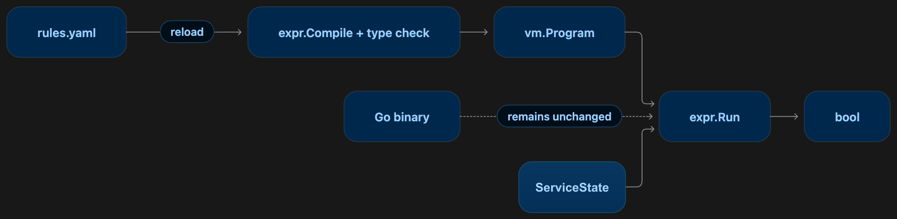

Сегодня я хочу немного отойти от типичных тем канала и поговорить о разработке на Go, а именно о библиотеке Expr и задачах, которые она решает.

Вы уже наверняка написали какое-то количество сервисов или программ, дополняющих вашу инфраструктуру на GoLang. Почти у каждого такого сервиса есть конфигурация. Например:

```yaml
min_replicas: 3
max_error_rate: 0.05
```

Типичная обработка этого выглядит примерно так:

```go
if readyReplicas >= cfg.MinReplicas && errorRate < cfg.MaxErrorRate {
	// продолжаем операцию
}
```

Пока конфигурация небольшая, этого достаточно. Но затем меняется уже форма правила: в production нужны три реплики, в остальных окружениях достаточно одной; во время maintenance проверку нужно пропустить; error rate учитывается только для части сервисов. В конфигурации появляются новые флаги и через некоторое время вы обнаруживаете кучу вложенных `if`, что делает код просто нечитабельным.

Но что если я вам скажу, что вместо цепочки `if` и вложенных условий можно хранить в конфигурации само правило. Expr скомпилирует его при загрузке или обновлении конфигурации, а затем приложение будет выполнять готовую программу с актуальными входными данными:

```yaml
rule: >-
  environment != "production" ||
  maintenanceMode ||
  (readyReplicas >= 3 && errorRate < 0.05)
```

При компиляции Expr проверит правило по Go-типам. Готовую программу затем можно многократно запускать с разными входными данными.

Давайте опишем структуру, которая одновременно будет служить входными данными и контрактом.

```go
type ServiceState struct {
	Environment     string  `expr:"environment"`
	MaintenanceMode bool    `expr:"maintenanceMode"`
	ReadyReplicas   int     `expr:"readyReplicas"`
	ErrorRate       float64 `expr:"errorRate"`
}
```

Теперь загрузим строку из конфигурации и скомпилируем её:

```go
program, err := expr.Compile(
	config.Rule,
	expr.Env(ServiceState{}),
	expr.AsBool(),
)
if err != nil {
	return fmt.Errorf("compile rule: %w", err)
}
```

После этого программу можно выполнить с реальными значениями:

```go
state := ServiceState{
	Environment:     "production",
	MaintenanceMode: false,
	ReadyReplicas:   3,
	ErrorRate:       0.02,
}

result, err := expr.Run(program, state)
if err != nil {
	return err
}

allowed := result.(bool) // true
```

Приложение ничего не знает о внутреннем устройстве условия. В конфигурации можно изменить порог, добавить исключение или полностью заменить правило — код вокруг `expr.Run` останется прежним.



Внутри `expr.Compile` строка сначала превращается в abstract syntax tree. Затем checker связывает имена с полями `ServiceState`, optimizer упрощает дерево, а compiler создаёт инструкции для stack-based virtual machine. При `expr.Run` VM выполняет эти инструкции с переданными значениями.

Главный практический выигрыш Expr довольно простой: меняется правило — обновляется конфигурация; меняется набор доступных данных или поведение самого приложения — тогда уже пересобирается Go-код. Эта граница позволяет убрать растущие цепочки `if`, не превращая конфигурацию в полноценный язык сценариев.


Такое устройство и позволяет крутить правила динамически: дорогостоящую подготовку мы выполняем один раз на reload, а не для каждого запроса. 

Playground и самая полная документация: https://expr-lang.org/
